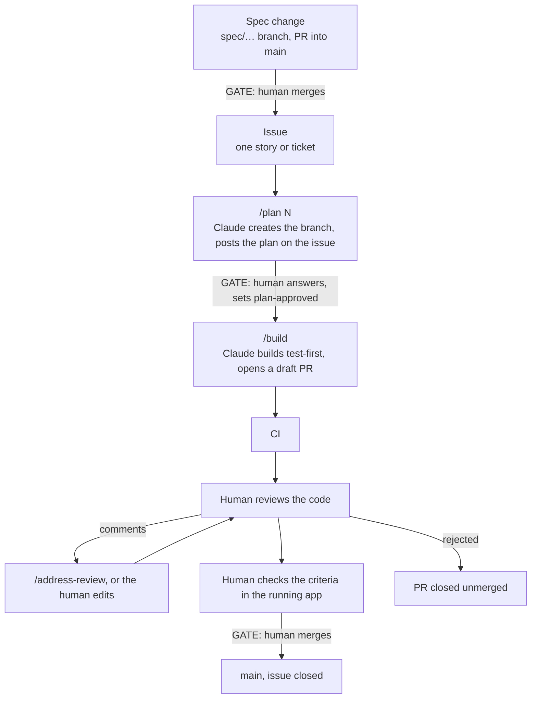

# Workflow — spec-driven generation with a human in the loop

*Every change to this file gets a line in the changelog at the bottom.*

## The idea

Humans write the spec. Claude plans and writes the code from it. **A human
engineer approves the plan before the build and reviews the code before the
merge.** Nothing reaches `main` unread.

Work is tracked the way GitHub projects usually track it: **an issue, a
branch, a pull request.** The harness adds two things to that: a plan the
human approves before code is written, and a spec the code is checked
against.

## Branches (ADR-002)

| Branch | What it is | Rules |
|--------|-----------|-------|
| `main` | The spec, the decisions, the harness, and the reviewed code in `app/` | Protected: changed only by pull request, with CI green and every review thread resolved. |
| `spec/<topic>`, `process/<topic>` | A change to the spec, or to the harness | Short-lived. PR into `main`. |
| `work/<issue>-<slug>` | The code for one issue | PR into `main` that closes the issue. If the PR is rejected, close it without merging. |

## Where things live

In the repository:

```
README.md              what the app is, for visitors and Players
CLAUDE.md              rules Claude follows in this repo (read automatically)
CONTEXT.md             glossary of domain terms (written by /grill-with-docs)
app/                   the code (appears with the first issue that builds)
docs/
  process/workflow.md  this file
  process/harness.md   the harness: what it is, how to start a project with it
  spec/                THE SPEC PACK: what Claude builds from
    vision.md            what the app is, for whom, why
    persona.md           the user and the non-negotiables
    constraints.md       legal, technical, organisational rules
    api_contracts.md     every external API the app calls
    roadmap.md           all features, in build order
    user_stories.md      stories + acceptance criteria
    features/<feature>/  per-feature spec from /to-spec
  adr/                 decisions, each with a "Revisit if:" trigger
  templates/           ADR, sensor report
  open_threads.md      what is still open
  handoff.md           the exact next step, for the next session
.claude/
  commands/            /plan, /build, /address-review, /sensor
  work-settings.json   permissions for work sessions (ADR-003)
  skills/              grilling, to-spec, to-tickets, tdd, …
.github/
  ISSUE_TEMPLATE/      the form for a piece of work
  pull_request_template.md
  branch-protection.json   the rules for main, applied once per repository
  workflows/ci.yml
```

On GitHub:

| Where | What |
|-------|------|
| The issue | The scope, Claude's plan, your answers, your approval (label `plan-approved`) |
| The pull request | The build record, the acceptance criteria as checkboxes, the review |

## The loop



### Phase 1 — Discover (human + Claude)

Run **`/grill-with-docs`** and describe the app idea. Claude interviews you in
rounds of numbered questions, each with its recommended answer. As terms
settle, Claude writes them into `CONTEXT.md`; as decisions settle, it drafts
ADRs. Cover at least: who the user is, what they do with the app, which
external APIs are involved, the stack, and what must never happen.

`/grill-me` is the same interview without writing files.

### Phase 2 — Specify (Claude drafts, human reviews)

On a `spec/<topic>` branch:

1. Fill `docs/spec/vision.md`, `persona.md`, `constraints.md`,
   `api_contracts.md` and `roadmap.md` (each file holds its own prompts).
2. Run **`/to-spec`** for a feature, then write its stories with
   Given/When/Then acceptance criteria into `docs/spec/user_stories.md`.
   **Each criterion must be checkable by a human in the running app.**

**Gate:** you read the spec PR and merge it.

#### Choosing the stack (once per project)

The harness does not fix a language or framework. Before the first issue is
built:

1. **In the spec PR:** an ADR for the stack (language, build tool, framework,
   storage) with its reasons. Prefer a stack you read fluently and whose
   toolchain checks a lot by itself: a reviewer's attention is the scarce
   resource. Decide in the same ADR, or a second one, how the structure is
   kept in shape by the build (for example layering rules as tests).
2. **In the same PR:** fill "Technical baseline" in
   `docs/spec/constraints.md`: the commands to run every test, to run the
   end-to-end tests and to start the app.
3. **In a `process/` PR:** replace the placeholder step of the `tests` job in
   `.github/workflows/ci.yml` with the toolchain setup and those commands,
   and add the routine build and test commands to the allow list in
   `.claude/work-settings.json` (ADR-003). Until this is done, CI fails as
   soon as `app/` exists.

### Phase 3 — Open an issue

One issue per piece of work, with the "Work item" form: what and why, the
stories or criteria in scope, what is out of scope. Write it yourself, or
run **`/to-tickets`** on a feature spec: Claude proposes thin end-to-end
slices and, once you agree, creates one issue per slice.

Keep an issue to one story or ticket. A bug is an issue too: name the
failing criterion and what you saw, not what you think the cause is.

### Phase 4 — Plan (Claude writes, **human approves**)

Start Claude with the work permissions (ADR-003) and name the issue:

```
claude --settings .claude/work-settings.json
/plan 12
```

Claude creates the branch `work/12-<slug>`, linked to the issue, reads the
spec and the code it will touch, and posts the plan as a comment on the
issue. Then it stops. The plan holds:

- the design in a few lines, and which ADRs it follows;
- the files it will create or change, with a size estimate;
- the tests it will write, one line each, by criterion;
- **every decision the spec leaves open, as a numbered question with a
  recommended answer**;
- the risky parts, where the reviewer should look hardest.

You answer the questions in a reply on the issue, object to whatever you
disagree with, and when you are satisfied add the label **`plan-approved`**.
Claude cannot set that label.

Why this gate exists: an assistant that builds first makes dozens of small
decisions alone, and a human asked afterwards tends to accept them all.
Answering before the build keeps the decisions yours. An answer that changes
what the app does goes into the spec as the first commit of the build, so
the spec stays the source.

### Phase 5 — Build (Claude alone)

Type **`/build`** (same session or a fresh one, on the work branch). Claude
checks for the label, builds test-first, runs the whole suite, pushes the
branch and opens a **draft** pull request that closes the issue. No
questions are expected here: if the plan turns out to be wrong, Claude stops
and asks on the issue.

### Phase 6 — Review (**human**)

Read the pull request in this order:

1. **The plan on the issue and the PR description**: what was meant, what
   Claude decided, what it says is risky or untested.
2. **The spec changes**, if any: are they exactly the answers you gave?
3. **The tests, before the implementation.** For each acceptance criterion:
   does the test assert what the criterion says, with expected values that
   come from the spec and not from the code? A test written by the author of
   the code can pass for the wrong reason; this is where you catch it.
4. **The risky paths**: anything touching secrets, authentication, sessions,
   input validation, outbound requests, data deletion.
5. **The rest of the implementation.**

Comment on the lines in the PR. Then either:

- type **`/address-review`**: Claude answers every comment with a commit or a
  reasoned reply, and you re-review; or
- **edit the code yourself** on the work branch. That is allowed and
  expected for small things. Your commits stay visible in the history under
  your name.

You resolve each thread when you are satisfied with it. Claude does not, and
`main` does not accept a pull request with an open thread.

### Phase 7 — Check in the running app (**human**)

Start the app from the work branch (`app/README.md` says how) and go through
the acceptance criteria in the PR description, ticking each one that holds.
A criterion that fails stays unticked and gets a comment, like any other
review finding.

### Phase 8 — Merge (**human**)

When CI is green, every thread is resolved and every box is ticked: mark the
pull request ready and merge it. The issue closes with it. If the attempt is
not worth fixing, close the pull request unmerged and say why in a comment;
the issue stays open for another try.

## Keeping issues reviewable

- **One story or one ticket per issue.** A rough limit: a few hundred lines
  of non-test code. Past that, reviews turn into skimming.
- If a plan estimates more, split the issue before building, not after.
- No refactoring mixed into a feature. A refactor is its own issue, with a
  plan that says "behaviour unchanged" and tests that prove it.

## What the machines check

So the reviewer can spend attention where it matters:

- **CI** on every PR and on `main`: once the stack is set up, the test suite
  and the end-to-end tests. A secret scan runs on every PR; a manual run of
  the workflow scans the whole history.
- **Structure checks**: architecture rules enforced by the build, so slow
  structural drift fails a test instead of depending on a reviewer who sees
  one small diff at a time.
- **Mutation testing**, where the stack has a tool for it: the score goes
  into the PR. A low score on changed code means the tests would not notice
  a bug there.
- **Dependency licences**, checked by the build where possible.
- An AI review (`/code-review`) may run first. It is a second reader for the
  human, never a substitute for the review.

## Guards

- **Branch protection on `main`** (`.github/branch-protection.json`,
  ADR-002): a pull request is required, the CI jobs `tests` and `secrets`
  must pass, every review conversation must be resolved, force pushes and
  deletion are off, and the rules bind the repository's owner too. Required
  approvals are 0 on purpose: GitHub does not let a pull request's author
  approve it, and with one account that author is always you.

  A repository made from the template does not inherit protection or labels.
  Once per repository, after the first push:

  ```
  gh api -X PUT "repos/{owner}/{repo}/branches/main/protection" --input .github/branch-protection.json
  gh label create plan-approved --description "The human approved the plan on this issue" --color 0E8A16
  ```

  The required checks only exist once CI has run on a pull request; if the
  first PR waits for them, open the PR's "Checks" tab to confirm they ran.

- **Work permissions** (`.claude/work-settings.json`, ADR-003): in a work
  session Claude's file tools cannot write the harness, and merging,
  approving or readying a pull request, editing an issue's labels, pushing
  to `main` and force-pushing are denied.

## Changelog
- **v1 (2026-10-13)** — first version: spec-driven generation with two human
  gates, plan approval and code review (ADR-001).
- **v1.1 (2026-10-13)** — the secret scan runs on pull requests and manual
  runs only. Why: on the first push of `main` the gitleaks action asks git
  for the parent of the first commit, fails, and turns CI red although
  nothing leaked. Every project made from this template would start that way.
- **v2 (2026-10-13)** — issue, branch, pull request (ADR-002 amended).
  `scripts/new-work.sh`, the `work/` folders with `plan.md` and `log.md`,
  the pre-push hook and `scripts/install-hooks.sh` are gone. A piece of work
  is a GitHub issue; `/plan <issue>` creates the linked branch and posts the
  plan on the issue; approval is the `plan-approved` label; the build record
  and the acceptance criteria are in the pull request; `main` is guarded by
  branch protection. Why: the scripts were home-made stand-ins for things
  GitHub provides and had to be learned first, and a local hook can be
  skipped. The cost: the plan and review record live on GitHub, not in the
  repository, and the harness no longer works without GitHub.
- **v2.1 (2026-10-14)** — the root `README.md` describes the app, not the
  harness; the harness overview moved to `docs/process/harness.md`. Why: the
  repository is public, and its front page should say what the app is.
